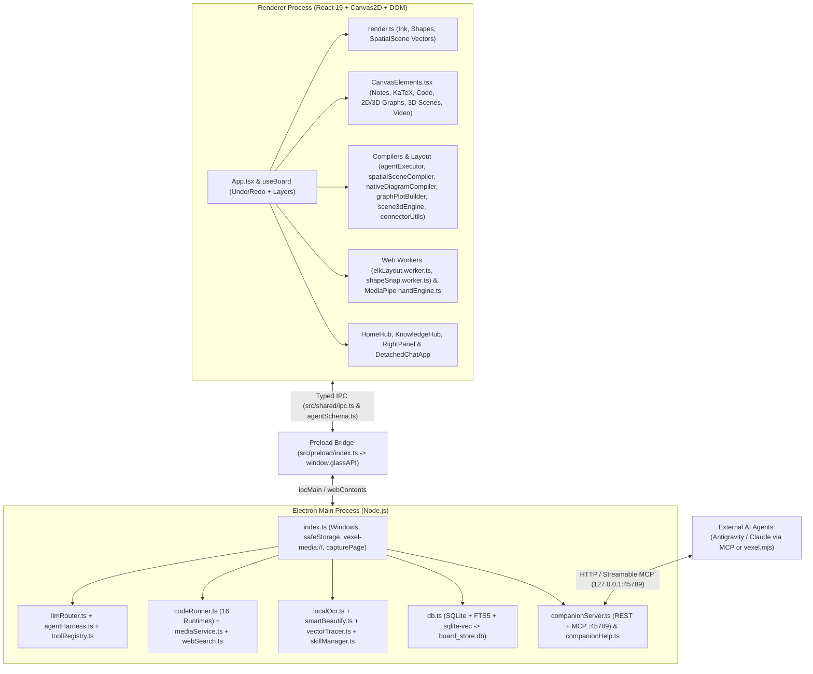

<p align="center">
  
</p>

<h1 align="center">Vexelboard</h1>

<p align="center">
  <strong>AI-powered interactive whiteboard &amp; study studio for Windows, macOS, and Linux.</strong>
</p>

<p align="center">
  <a href="https://github.com/GT0096/vexelBoard/releases/latest"></a>
  <a href="LICENSE"></a>
  
  
  
</p>

**Vexelboard** is a local-first, AI-powered desktop whiteboard and study studio built with **Electron**, **React**, **TypeScript**, and **Vite** in a bold **Neo-Brutalist** interface.

It brings together an infinite multi-layer drawing canvas, background-adaptive color palettes, **SpatialScene** vector illustrations, interactive **React Flow** and ELK-laid-out diagrams, a **347+ SVG shape library**, Markdown/KaTeX/Mermaid note cards, **16-type 2D/3D Graph Cards**, canvas-immersed **3D Scenes**, an embedded **16-language Code Studio** with live **Visual Code Pipelines**, playable YouTube study cards, a local **Knowledge Studio** (SQLite + `sqlite-vec` hybrid RAG), multi-provider AI agents, and a local **MCP Companion Server** (`http://127.0.0.1:45789/mcp`) for **Antigravity** and **Claude**.

**Jump to:** [Features](#features) · [Architecture](#architecture) · [User Guide](#user-guide--how-to-use-vexelboard) · [Keyboard Shortcuts](#keyboard-shortcuts) · [Development & Tests](#installation-development--testing) · [Building Installers](#building-desktop-executables--installers) · [Extended Wiki Guide](wiki/User-Guide.md)

---

## Features

- **Infinite Multi-Layer Whiteboard & Adaptive Palettes**: Smooth pan/zoom canvas with Solid, Dot Matrix, or Graph Grid textures, WCAG background-adaptive palettes, a 3-layer stack (`Annotations`, `Cards & Widgets`, `Base Canvas`) with visibility/lock/opacity controls, and **Transparent Glass + Click-Through (`Alt+Space`)** desktop overlay mode.
- **Pen, Hold-to-Snap, Writing Pad OCR & Vectorize**: 5 pen types (`Ballpoint`, `Fountain`, `Marker`, `Highlight`, `Dashed`), paper & section erasers, Hold-to-Snap shape recognition, Writing Pad Text/Equation OCR (`localOcr.ts`), AI **Beautify (`Ctrl+B`)**, and **Vectorize (`Ctrl+Shift+B`)** with multi-color tracing (`@visioncortex/vtracer` + `svgo`) and visual critic refinement.
- **Notes, Equations, Stickies, Shapes & Diagrams**: Markdown/LaTeX/Mermaid/` ```3d ` note cards with in-note sketching, KaTeX equations, 347+ SVG shapes across 15 categories, animated connectors, 1-click diagram templates, **SpatialScene** vector illustrations, and ELK/Dagre-powered diagrams.
- **Interactive 2D/3D Graph Cards & 3D Scenes**: Movable, resizable Plotly/GeoGebra-style Graph Cards covering **16 chart types** (`function`, `line`, `smooth`, `area`, `bar`, `histogram`, `scatter`, `pie`, `violin`, `box`, `candlestick`, `heatmap`, `surface3d`, `scatter3d`, `line3d`, `bar3d`) plus canvas-immersed interactive **3D Scenes** (`car`, `optics_bench`, `mechanics_rig`, `chemistry_setup`, `electromagnetism`, `surface_wave`, or custom 3D primitives).
- **Code Studio & Visual Code Pipelines**: Multi-tab CodeMirror 6 cards executing **16 local languages** (`Python`, `JavaScript`, `TypeScript`, `C++`, `C`, `Java`, `Go`, `Rust`, `R`, `Ruby`, `PHP`, `C#`, `PowerShell`, `Bash`, `Lua`, `Perl`) plus live `HTML / CSS / JS` preview, with click-to-chain `Code → Code → Graph / 3D Scene` data pipelines.
- **Knowledge Studio (Local RAG) & YouTube Study Cards**: Index `.pdf`, `.txt`, `.md`, code files, YouTube transcripts, and whiteboard snapshots into local SQLite + `sqlite-vec` hybrid FTS5/vector search; generate Study Guides, FAQ/Quizzes, Podcast Scripts, Visual Tutorials, and Board Recall, or pin `@book` citations directly in AI Chat.
- **Multi-Step AI Agent, Detached Chat & Skills**: ReAct agent harness with board inspection/mutation tools, built-in meta-search / optional SearXNG, custom AI Skills manager, and pop-out detached chat window for multi-monitor setups.
- **Antigravity & Claude Companion Bridge (HTTP + MCP)**: Local Streamable HTTP MCP server (`http://127.0.0.1:45789/mcp`) and `vexel.mjs` CLI with full board inspection (including `SpatialScene` `vectorGroups`, connectors, and `boardBounds`), explicit `x`/`y`/`w`/`h`/`id` placement, `move_elements`, group-aware `delete_elements`, and full-board/viewport PNG capture (`capture-board` / `capture-viewport`).

---

## Architecture

Vexelboard uses Electron's three-process security model (**Main Process** for OS/DB/AI/code/MCP I/O, **Preload Bridge** exposing a typed `window.glassAPI`, and **React 19 Renderer** for canvas rendering, card UI, and Web Workers).

### High-Level System Architecture



### Core Subsystems

1. **Dual-Layer Infinite Canvas & Board State (`src/renderer/src/App.tsx`, `board/render.ts`, `components/CanvasElements.tsx`)**
   - Freehand strokes (`perfect-freehand`), geometric shapes, connectors, traced vector art, and board-immersed text render on a high-DPI HTML5 Canvas (`render.ts`) synchronized with pan/zoom transforms.
   - Interactive cards (Markdown notes, KaTeX equations, CodeMirror code editors, 2D/3D Graph Cards, 3D Scenes, React Flow diagrams, YouTube players) render as positioned DOM overlays (`CanvasElements.tsx`) ordered alongside a 3-layer stack (`layer-overlay-ink`, `layer-cards`, `layer-base-ink`) managed in `board/layerUtils.ts`.
   - Boards auto-save into project/section records (`board/workspaceStore.ts` + SQLite `board_store.db` via `src/main/db.ts`).

2. **Vectorization, Beautify & Diagram Compilers (`src/main/smartBeautify.ts`, `vectorTracer.ts`, `board/spatialSceneCompiler.ts`, `nativeDiagramCompiler.ts`, `elkDiagramLayout.ts`)**
   - Rough sketches are rasterized (`board/vectorizeUtils.ts`) and either traced locally (`@visioncortex/vtracer` + `svgo`), recognized with local OCR (`localOcr.ts`), or converted by AI into structured `SpatialScene` JSON or ELK-laid-out `DiagramGraph` specs (`workers/elkLayout.worker.ts`).
   - `spatialSceneCompiler.ts` compiles `0..1000` normalized `SpatialScene` primitives (`shape`, `svg_path`, `connector`, `cell_strip`, `text`) into native `ShapeNode`s + immersed `TextNode`s tagged by `vectorGroupId`, with container-aware text collision avoidance.

3. **Multi-Step AI Agent & Knowledge Studio (`src/main/llmRouter.ts`, `agent/agentHarness.ts`, `agent/toolRegistry.ts`, `db.ts`, `webSearch.ts`, `mediaService.ts`)**
   - `llmRouter.ts` routes requests across local **Ollama** and encrypted BYOK cloud providers (**OpenAI**, **Google Gemini**, **xAI Grok**, **Anthropic Claude**).
   - `agentHarness.ts` runs a ReAct tool loop (board inspection, Knowledge Studio search, web search / optional SearXNG, local code execution, and batched board mutations applied through `board/agentExecutor.ts`).
   - `db.ts` stores projects, sections, chat threads, board snapshots, history events, and Knowledge Studio document chunks with hybrid FTS5 + `sqlite-vec` search (`better-sqlite3` with `node:sqlite` fallback).

4. **Code Studio & Visual Code Pipelines (`src/main/codeRunner.ts`, `board/codeVisualParser.ts`, `board/connectorUtils.ts`, `board/graphPlotBuilder.ts`, `board/scene3dEngine.ts`)**
   - `codeRunner.ts` executes snippets locally across 16 languages with process-tree timeouts and `stdin` piping.
   - Bound connectors (`connectorUtils.ts`) link `Code → Code → Graph / 3D Scene`; `codeVisualParser.ts` parses returned dicts/JSON into 2D/3D Graph specs (`CanvasGraphCard.tsx`) or 3D Scene assemblies (`Canvas3DScene.tsx`).

5. **Companion HTTP & Streamable MCP Server (`src/main/companionServer.ts`, `src/main/companionHelp.ts`, `.agents/skills/vexelboard-canvas/scripts/vexel.mjs`)**
   - Starts on `127.0.0.1:45789` (falling back across `45789–45795`) and publishes connection metadata to `~/.vexelboard-bridge.json`.
   - Exposes REST (`/api/status`, `/api/board`, `/api/board-image`, `/api/selection-image`, `/api/board/mutate`, `/api/knowledge/search`, `/api/help`) and MCP JSON-RPC (`POST /mcp`) backed by live renderer snapshots (`buildAgentBoardSnapshot`), explicit-coordinate & group-aware mutations (`applyAgentMutationsToBoard`), and full-board/viewport PNG capture via `mainWindow.webContents.capturePage()`.

### Tech Stack

| Layer | Technologies |
| --- | --- |
| **Desktop Shell** | Electron 44, `electron-vite` 6, `electron-builder` 26 |
| **Frontend UI** | React 19, TypeScript 5, Vite 8, Lucide Icons, Neo-Brutalist CSS |
| **Canvas, Diagrams & Math** | HTML5 Canvas (`perfect-freehand`), `@xyflow/react`, `elkjs`, `dagre`, `mermaid`, `katex`, `react-markdown` |
| **Code Editor** | `@uiw/react-codemirror` |
| **Vectorization & Vision** | `@visioncortex/vtracer`, `svgo`, `@huggingface/transformers`, `@mediapipe/tasks-vision` |
| **Local Storage & RAG** | `better-sqlite3` / `node:sqlite`, `sqlite-vec`, `pdf-parse`, `minisearch`, `youtube-transcript` |
| **Validation** | `zod` (`src/shared/agentSchema.ts`, `beautifySchema.ts`, `scene3dSchema.ts`) |

### Project Structure

```text
vexelboard/
├── .agents/skills/                 # Workspace companion skills & CLI
│   ├── vexelboard-canvas/          # SKILL.md, references/, scripts/vexel.mjs
│   └── vexelboard-knowledge/       # SKILL.md & Knowledge Studio search workflow
├── build/                          # App icons, Windows installer.nsh, macOS scripts, entitlements
├── public/
│   ├── favicon.svg                 # Vexelboard Kinetic V Nib SVG favicon
│   └── mediapipe/                  # Offline MediaPipe WASM & hand-tracking assets
├── resources/                      # Unpacked runtime assets (logo.svg, icon.png, icon.ico)
├── scripts/                        # Codegen scripts (generate-shape-library.mjs)
├── src/
│   ├── main/                       # Electron main process
│   │   ├── agent/                  # agentHarness.ts & toolRegistry.ts
│   │   ├── codeRunner.ts           # 16-language local process runner
│   │   ├── companionHelp.ts        # Compact MCP/REST payload cheat-sheets
│   │   ├── companionServer.ts      # Local HTTP + Streamable MCP server (:45789)
│   │   ├── db.ts                   # SQLite + FTS5 + sqlite-vec persistence & RAG
│   │   ├── index.ts                # App lifecycle, IPC, safeStorage, capturePage, protocol
│   │   ├── llmRouter.ts            # Ollama + OpenAI/Gemini/Grok/Claude router
│   │   ├── localOcr.ts             # Local handwriting/OCR support
│   │   ├── mediaService.ts         # PDF/text/code parsing & YouTube transcripts
│   │   ├── skillManager.ts         # Custom & workspace skill discovery
│   │   ├── smartBeautify.ts        # AI diagram/vectorization synthesis & critique
│   │   ├── vectorTracer.ts         # Multi-color raster-to-SVG tracer (vtracer + svgo)
│   │   └── webSearch.ts            # Built-in metasearch & optional SearXNG client
│   ├── preload/                    # Context-isolated preload bridge (window.glassAPI)
│   ├── shared/                     # Shared schemas & contracts (ipc, agent, beautify, scene3d, catalog)
│   └── renderer/
│       ├── index.html              # Renderer entry HTML & CSP
│       └── src/
│           ├── App.tsx             # Main canvas controller, state, IPC & overlays
│           ├── board/              # agentExecutor, spatialSceneCompiler, nativeDiagramCompiler,
│           │                       # elkDiagramLayout, graphPlotBuilder, scene3dEngine, connectorUtils,
│           │                       # codeVisualParser, placementUtils, render, vectorizeUtils, store
│           ├── components/         # Toolbar, LeftDockToolbar, CanvasElements, CanvasGraphCard,
│           │                       # Canvas3DScene, CodeStudioPanel, KnowledgeHub, HomeHub,
│           │                       # RightPanel, DetachedChatApp, LayersPanel, SettingsModal, etc.
│           ├── shapes/             # 347+ SVG shape library catalog & renderer
│           ├── types/              # Whiteboard domain types (board.ts)
│           ├── vision/             # MediaPipe handEngine, shapeSnapper, localShapeDetector, OneEuroFilter
│           └── workers/            # elkLayout.worker.ts & shapeSnap.worker.ts
├── tests/                          # Node unit & integration tests
├── wiki/                           # Extended Functional User Guide (wiki/User-Guide.md)
├── electron-builder.yml            # Windows, macOS & Linux installer config
├── electron.vite.config.ts         # Main, preload & renderer Vite configuration
├── LICENSE                         # Apache License 2.0
└── package.json
```

---

## User Guide — How to Use Vexelboard

> Looking for every detail? See the full **[Functional User Guide](wiki/User-Guide.md)** in `wiki/`.

### 1. First Launch & AI Setup

1. Launch **Vexelboard** (from an installer or `npm run dev`).
2. Click **AI Settings** in the Top Bar (or the `⚙` icon inside the Bottom Toolbar / AI Panel) to choose an AI provider:
   - **Ollama (Local / Private)**: Default host `http://localhost:11434`, default model `gemma4`. Click **Re-check** to discover your installed models.
   - **Cloud Providers (BYOK)**: Choose **OpenAI** (`gpt-4o`), **Google Gemini** (`gemini-2.0-flash`), **xAI Grok** (`grok-2-vision-1212`), or **Anthropic Claude** (`claude-3-7-sonnet-20250219`). API keys are encrypted locally using Electron `safeStorage`.
   - **Custom Models & Temperature**: Enter any custom model ID and pick a preset (`Precise 0.1`, `Balanced 0.3`, `Creative 0.7`, `High / Reasoning 1.0`).

### 2. Organizing Work with Home Hub, Projects & Sections

- **Projects**: On the Home Hub, click **New Project** to create a workspace for a course, codebase, or research topic (title, description, accent color, and first section).
- **Topic Sections**: Each project contains multiple infinite whiteboards (**Sections**). Click any section card to open its canvas, or use the **Project → Section** breadcrumb in the Top Bar to switch/create sections without leaving the board.
- **Resume & History**: Use the **Resume** button to jump straight back to your last active board, filter **Overall History** across notes/diagrams/code/sources, or switch between **Chats** and **Creations** inside a project.

### 3. Navigating the Canvas, Backgrounds, Layers & Overlay Mode

- **Pan & Zoom**: Use **Pan (`H`)**, hold **`Space` + Drag**, or **Middle-Mouse / `Alt` + Drag** to pan; use **`Ctrl` / `Cmd` + Wheel**, trackpad pinch, or the Bottom Toolbar zoom controls (`25%–300%`) to zoom. Click **`Fit` (`Shift+1`)** to frame all board content or **`100%` (`Ctrl+0`)** to reset zoom.
- **Adaptive Backgrounds**: Click **Bg** in the Bottom Toolbar to choose from 10 curated presets (**Studio Cream**, **Crisp Whiteboard**, **Butter Sketch**, **Mint Studio**, **Sky Grid**, **Lilac Pop**, **Peach Sorbet**, **Matcha Chalk**, **Cobalt Blueprint**, **Transparent Glass**) or any custom hex color, plus **Solid**, **Dot Matrix**, or **Graph Grid** textures. Ink, shapes, and cards automatically adapt contrast.
- **Layers**: Open the **Layers** panel to toggle visibility, lock state, or opacity independently for `Annotations (Top)`, `Cards & Widgets`, and `Base Canvas`.
- **Desktop Overlay (Click-Through)**: Select **Transparent Glass** and press **`Alt+Space`** globally to let mouse clicks pass through the whiteboard to apps underneath; press **`Alt+Space`** again to resume drawing.

### 4. Drawing, Writing Pad OCR, Vectorize & Erasing

- **Pen (`P`)**: Choose `Ballpoint`, `Fountain`, `Marker`, `Highlight`, or `Dashed`, pick adaptive swatches or a custom color, and adjust thickness (`1px–24px`).
- **Writing Pad Modes**: Open the **`Pad`** dropdown to switch between **Freehand Ink (`NONE`)**, **Text OCR (`TEXT`)** (handwriting → editable text), and **Equation OCR (`EQUATION`)** (handwritten math → KaTeX equation cards).
- **Hold-to-Snap**: Pause briefly at the end of a rough stroke to snap circles, rectangles, triangles, lines, or arrows into crisp shapes.
- **Eraser (`E`)**: Switch between **Paper Eraser** (`10px–160px`) and **Section Delete** (box-select a region to remove).
- **AI Beautify (`Ctrl+B`) & Vectorize (`Ctrl+Shift+B`)**: Select rough strokes (or let Vexelboard auto-detect recent ink) and click **Beautify** to convert into an interactive diagram, or **Vectorize** to trace/synthesize crisp board-immersed vectors and text.
- **Hand Gesture Control**: Click **Hand** in the Bottom Toolbar to optionally enable webcam MediaPipe hand tracking.

### 5. Notes, Equations, Shapes, Stickies & Diagrams

- **Markdown Notes (`T`)**: Press `T` and click the canvas to drop a note card. Double-click to edit Markdown, inline LaTeX math, code blocks, tables, **Mermaid** diagrams, or embedded ```` ```3d ```` scenes. Use the note quick bar to toggle `H1`/`H2`/Body, sketch freehand directly inside the note, change card color, or auto-fit size.
- **Equations**: Insert or double-click any KaTeX card to edit its LaTeX directly.
- **Shapes, Stickies & Templates (Left Dock)**: Browse **347+ SVG shapes** across 15 categories, insert **animated connectors**, drop color-coded sticky notes, or spawn 1-click templates (**Standard Flowchart**, **Cloud Architecture**, **Mindmap**, **ERD**, **User Journey**).
- **Interactive Diagrams**: Drag nodes, drag from directional port handles (`Top`, `Bottom`, `Left`, `Right`) to wire edges, double-click labels to edit, or run **Auto-Layout** (`TB` / `LR`).

### 6. Interactive 2D/3D Graph Cards & 3D Scenes

- **16 Chart Types**: Plot expressions (`function`) or datasets (`line`, `smooth`, `area`, `bar`, `histogram`, `scatter`, `pie`, `violin`, `box`, `candlestick`, `heatmap`, `surface3d`, `scatter3d`, `line3d`, `bar3d`) inside movable, resizable **Graph Cards**.
- **Customize & Explore**: Open a Graph Card's **Customize** drawer to change palettes, per-series colors, axis styles (`origin`, `frame`, `box`, `none`), grid/background colors, and legend position. On 3D graphs, drag to **Orbit**, hold **`Shift+Drag`** (or toggle **Move**) to pan, scroll to zoom, and click **Center & Reset**.
- **3D Scenes**: Add canvas-immersed 3D rigs (`car`, `optics_bench`, `mechanics_rig`, `chemistry_setup`, `electromagnetism`, `surface_wave`, or custom 3D primitives) directly on the board or inside notes.

### 7. Embedded Code Studio & Visual Code Pipelines

1. Click **Code (`</>`)** in the Left Dock to drop a multi-tab Code Card.
2. Pick any of **16 locally runnable languages** (`Python`, `JavaScript`, `TypeScript`, `C++`, `C`, `Java`, `Go`, `Rust`, `R`, `Ruby`, `PHP`, `C#`, `PowerShell`, `Bash`, `Lua`, `Perl`) or **`HTML / CSS / JS (Live)`**, optionally pass `stdin`, and press **`Ctrl+Enter`** (or click **Run**).
3. **Chain Pipelines**: Click or drag a Code Card's **cyan connector dot** to wire `Code → Code → Graph / 3D Scene`. Running any upstream card automatically executes downstream stages and updates linked graphs/3D scenes:

```python
# Stage 1 (Generator Code Card) -> auto-emits JSON to downstream stages
x = [0, 1, 2, 3, 4, 5]
y = [v ** 2 for v in x]
```

```python
# Stage 2 (Connected Code Card -> Connected Graph Card)
def transform(data):
    return {
        "type": "line",
        "title": "Scaled Squares",
        "x": data["x"],
        "y": [val * 0.5 for val in data["y"]],
    }
```

### 8. YouTube Study Cards & Knowledge Studio (Local RAG)

- **YouTube Cards**: Click **Video** in the Left Dock (or **Pin** a YouTube link in Chat/Knowledge Studio), paste a URL, click transcript lines to seek, click **`Add Note @ mm:ss`** for timestamped study notes, or click **Tutorial** to generate a whiteboard lesson from captions.
- **Knowledge Studio**: Open **Knowledge Studio** (`📖` in the Left Dock) to:
  - Index `.pdf`, `.txt`, `.md`, code files, YouTube transcripts, and current **Whiteboard** snapshots into local SQLite + `sqlite-vec`.
  - Generate **Study Guides**, **FAQ & Practice Quizzes**, **Podcast Scripts**, and **Visual Whiteboard Tutorials** in one click.
  - Run **Board Recall** (*Ask Board*, *Trace Line of Thought*, *Synthesize Concept Map*).

### 9. AI Co-Pilot, Detached Chat & External Agents (Antigravity / Claude MCP)

- **In-App AI Co-Pilot**: Click **AI Panel** in the Top Bar (or pop it out via **`↗`** onto a second monitor). Attach files/images/YouTube, type **`@`** (or click **Books**) to pin Knowledge Studio sources, toggle **Project Context**, and turn replies into board items with **Add to Notes**, **Highlight-to-Note**, **Create Diagram**, or **To Tutorial**.
- **External Agents via MCP & CLI**: While Vexelboard is running, external agents like **Antigravity** and **Claude** connect via `http://127.0.0.1:45789/mcp` (discovered automatically from `~/.vexelboard-bridge.json`) or the workspace CLI:

```bash
# Inspect bridge status & full board JSON (notes, diagrams, SpatialScene vectorGroups, connectors, boardBounds)
node .agents/skills/vexelboard-canvas/scripts/vexel.mjs status
node .agents/skills/vexelboard-canvas/scripts/vexel.mjs board

# Visually capture the full board, current viewport, or a world region as PNG
node .agents/skills/vexelboard-canvas/scripts/vexel.mjs capture-board
node .agents/skills/vexelboard-canvas/scripts/vexel.mjs capture-viewport

# Place cards/diagrams at explicit coordinates (or omit --x/--y to auto-place)
node .agents/skills/vexelboard-canvas/scripts/vexel.mjs add-note --id note-1 --x 100 --y 100 --title "Step 1" --content "Overview"
node .agents/skills/vexelboard-canvas/scripts/vexel.mjs add-equation --id eq-1 --x 100 --y 340 --latex "O(V + E)"
node .agents/skills/vexelboard-canvas/scripts/vexel.mjs add-code --id code-1 --x 520 --y 100 --language python --code "x=[1,2,3]\ny=[2,4,6]"

# Move/resize cards or entire SpatialScene/diagram groups (auto-reroutes connectors) & delete by ID or group ID
node .agents/skills/vexelboard-canvas/scripts/vexel.mjs move-elements --id note-1 --x 140 --y 120
node .agents/skills/vexelboard-canvas/scripts/vexel.mjs delete-elements --ids note-1
```

### 10. Exporting & Local Privacy

- Click **Export** in the Top Bar to save your board as **SVG**, **PNG / JPEG**, or **Print to PDF**.
- All projects, sections, boards, chat threads, and Knowledge Studio indexes remain local in `board_store.db` under Electron's `userData` directory, and cloud API keys are encrypted with `safeStorage`.

---

## Keyboard Shortcuts

| Shortcut | Action |
| --- | --- |
| `V` | Select & Move tool |
| `H` or hold `Space` + Drag | Pan canvas |
| `P` | Pen / Writing Pad tool |
| `T` | Insert Text / Markdown note tool |
| `E` | Eraser tool |
| `Ctrl+Z` / `Cmd+Z` | Undo |
| `Ctrl+Y` or `Ctrl+Shift+Z` / `Cmd+Shift+Z` | Redo |
| `Ctrl+B` / `Cmd+B` | AI Beautify selected sketch into diagram |
| `Ctrl+Shift+B` / `Cmd+Shift+B` | Vectorize selected drawing into crisp vectors & text |
| `Ctrl+0` / `Cmd+0` | Reset zoom to `100%` |
| `Shift+1` | Fit board view to content |
| `Arrow Keys` (`+ Shift` for `10px`) | Nudge selected elements |
| `Delete` / `Backspace` | Delete selected elements |
| `Escape` | Clear selection / close editor |
| `Alt+Space` *(Global)* | Toggle Click-Through Desktop Overlay mode |
| `Ctrl+Enter` *(Code Studio)* | Run snippet or update Live HTML preview |
| `@` *(AI Chat)* | Autocomplete & pin Knowledge Studio sources |

---

## Installation, Development & Testing

### Prerequisites

- **Node.js** `>= 20` and **npm**
- *(Optional)* **Ollama** running locally (`http://localhost:11434`) for local AI inference, or an API key for OpenAI / Gemini / Grok / Claude (configured inside **AI Settings**).
- *(Optional)* Local compilers/interpreters (`python`, `node`, `javac`/`java`, `go`, etc.) for running snippets in Code Studio.

### Setup & Run Locally

```bash
# 1. Clone the repository
git clone https://github.com/GT0096/vexelBoard.git
cd vexelBoard

# 2. Install dependencies
npm install

# 3. Start Electron in development mode (with hot reload)
npm run dev
```

### Scripts & Unit Tests

```bash
npm run typecheck         # Type-check main/preload (node) and renderer (web)
npm run lint              # Run ESLint across the repository
npm run format            # Format code with Prettier
npm run build             # Type-check + build production bundles into out/
npm start                 # Preview the production build locally

# Run board compiler, placement, connector, and companion server tests (Node >= 22)
node --experimental-strip-types --test tests/spatialSceneCompiler.test.ts tests/placementUtils.test.ts tests/companionAndLayout.test.ts tests/connectorUtils.test.ts tests/nativeDiagramCompiler.test.ts
```

---

## Building Desktop Executables & Installers

Packaging is configured via [electron-builder.yml](electron-builder.yml) and outputs installers into `dist/`.

### Windows (`.exe` Installer)

```bash
npm run build:win
```

Produces:

- `dist/Vexelboard-<version>-Setup.exe` — Interactive NSIS installer (customizable install directory, Desktop & Start Menu shortcuts, Windows `App Paths` + `PATH` registration for Windows Search / `Win + R` / terminal launch, in-place update or uninstall option when already installed, auto-launch on finish).
- `dist/win-unpacked/Vexelboard.exe` — Standalone unpacked Windows executable.

### macOS (`.dmg` & `.zip`)

Run on a macOS machine:

```bash
npm run build:mac
# Or build a single universal binary:
npm run build:mac:universal
```

Produces Apple Silicon (`arm64`) and Intel (`x64`) installers in `dist/`:

- `Vexelboard-<version>-arm64.dmg` & `Vexelboard-<version>-x64.dmg` — Drag-and-drop **Vexelboard.app** into `/Applications`, or run **`Update or Uninstall Vexelboard.command`** inside the DMG to install, update in place, or uninstall.
- `Vexelboard-<version>-arm64.zip` & `Vexelboard-<version>-x64.zip`

> **Building `.dmg` from Windows or CI:** Apple's `.dmg` packager only runs on macOS. You can build macOS installers automatically on GitHub Actions using [release.yml](.github/workflows/release.yml) (**Actions → Release Installers → Run workflow**, or push a `v*` tag). For unsigned builds on macOS Gatekeeper, right-click **Vexelboard.app → Open** (or run `xattr -cr /Applications/Vexelboard.app`) on first launch.

### Linux (`AppImage` & `deb`)

```bash
npm run build:linux
```

### Unpacked Directory Only

```bash
npm run build:unpack
```

---

## Contributing

Contributions are welcome! Please read [contribution.md](contribution.md) before opening a pull request.

---

## License

This project is licensed under the [Apache License 2.0](LICENSE).
