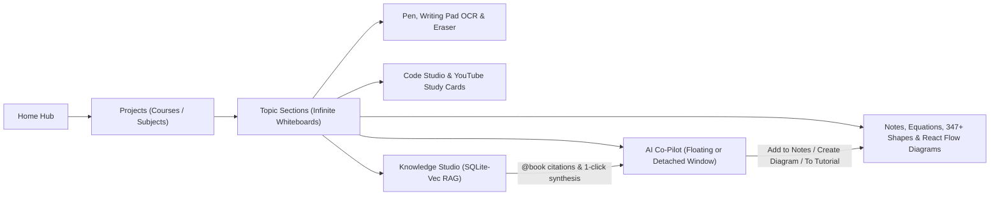

# Vexelboard — Functional User Guide

> **AI-powered interactive desktop whiteboard & study studio for Windows, macOS, and Linux.**

**Vexelboard** combines an infinite Neo-Brutalist drawing canvas, background-adaptive color palettes, interactive diagrams and a 347+ SVG shape library, Markdown/LaTeX/Mermaid note cards, an embedded multi-language Code Studio, playable YouTube study cards, a local **Knowledge Studio** (SQLite + `sqlite-vec` hybrid RAG), and a flexible multi-provider AI Co-Pilot in one local-first desktop application.

---

## Table of Contents

- [Workspace Overview](#workspace-overview)
- [1. Getting Started & AI Provider Setup](#1-getting-started--ai-provider-setup)
- [2. Home Hub: Projects, Sections & History](#2-home-hub-projects-sections--history)
- [3. Navigating the Infinite Canvas & Appearance](#3-navigating-the-infinite-canvas--appearance)
- [4. Drawing, Writing Pad OCR & Erasing](#4-drawing-writing-pad-ocr--erasing)
- [5. Notes, Equations, Shapes, Stickies & Diagrams](#5-notes-equations-shapes-stickies--diagrams)
- [6. Embedded Code Studio](#6-embedded-code-studio)
- [7. Interactive YouTube Video Study Cards](#7-interactive-youtube-video-study-cards)
- [8. AI Co-Pilot Chat & Detached Multi-Monitor Mode](#8-ai-co-pilot-chat--detached-multi-monitor-mode)
- [9. Knowledge Studio (Local RAG, Synthesis & Recall)](#9-knowledge-studio-local-rag-synthesis--recall)
- [10. Keyboard Shortcuts & Controls Reference](#10-keyboard-shortcuts--controls-reference)
- [11. Local Storage, Privacy & Troubleshooting](#11-local-storage-privacy--troubleshooting)

---

## Workspace Overview

Vexelboard organizes your work into **Projects** (courses, systems, or subjects) and focused **Topic Sections** (dedicated infinite whiteboards). Every section shares your project's AI chat threads and Knowledge Studio library.

---

## 1. Getting Started & AI Provider Setup

### Downloading & Installing Vexelboard

Download the latest desktop installer directly from GitHub Releases (these links always point to the newest published version automatically):

| Platform | Architecture | Direct Download |
| --- | --- | --- |
| **Windows** | 64-bit (`x64`) | [Download Vexelboard-latest-Setup.exe](https://github.com/GT0096/vexelBoard/releases/latest/download/Vexelboard-latest-Setup.exe) |
| **macOS** | Apple Silicon (`arm64` — M-series: M1 &amp; newer) | [Download Vexelboard-latest-arm64.dmg](https://github.com/GT0096/vexelBoard/releases/latest/download/Vexelboard-latest-arm64.dmg) |
| **macOS** | Intel (`x64`) | [Download Vexelboard-latest-x64.dmg](https://github.com/GT0096/vexelBoard/releases/latest/download/Vexelboard-latest-x64.dmg) |

You can also browse `.zip` archives and release notes on the [Latest Release page](https://github.com/GT0096/vexelBoard/releases/latest).

### Launching, Updating & Uninstalling Vexelboard

- **Windows**: Run `Vexelboard-latest-Setup.exe` (adds Desktop/Start Menu shortcuts and registers `Vexelboard` on `PATH` and Windows Search). If Vexelboard is already installed, the setup automatically offers **Update / Reinstall** (preserving your boards & Knowledge Studio) or **Uninstall** from the same installer.
- **macOS**: Open `Vexelboard-latest-arm64.dmg` (Apple Silicon) or `Vexelboard-latest-x64.dmg` (Intel). Drag **Vexelboard.app** to `/Applications`, or double-click **`Update or Uninstall Vexelboard.command`** inside the DMG to install, update in place (preserving your data), or uninstall cleanly.
  > [!NOTE]
  > For unsigned macOS builds, running **`Update or Uninstall Vexelboard.command`** clears Gatekeeper quarantine automatically. If dragging manually, right-click **Vexelboard.app → Open** (or run `xattr -cr /Applications/Vexelboard.app`) on first launch.
- **Linux**: Build or launch the `AppImage` / `.deb` package from source (`npm run build:linux`).

### Configuring AI Models & Providers

You can configure AI settings from **AI Settings** in the Top Bar (on the Home Hub), the **Settings** (`⚙`) button in the Bottom Toolbar, or directly inside the **AI Co-Pilot Panel** (`⚙` button).

| Provider | Connection Type | Default Model | Notes |
| --- | --- | --- | --- |
| **Ollama** | Local or remote host (default `http://localhost:11434`) | `gemma4` | Auto-discovers installed Ollama models; click **Re-check / Check** to verify connection status. |
| **OpenAI** | Bring Your Own Key (BYOK) | `gpt-4o` | Supports auto-configured ideal temperature & reasoning profiles per model (e.g., `gpt-4o`, `gpt-4.1`, `gpt-4o-mini`, `o3-mini`, `o1`, `o4-mini`). |
| **Google Gemini** | Bring Your Own Key (BYOK) | `gemini-2.0-flash` | Popular presets include `gemini-2.0-flash`, `gemini-2.5-flash`, `gemini-1.5-flash`, `gemini-1.5-pro`. |
| **xAI Grok** | Bring Your Own Key (BYOK) | `grok-2-vision-1212` | Popular presets include `grok-2-vision-1212`, `grok-3`, `grok-2-1212`. |
| **Anthropic Claude** | Bring Your Own Key (BYOK) | `claude-3-7-sonnet-20250219` | Popular presets include `claude-3-7-sonnet`, `claude-3-5-sonnet`, `claude-3-5-haiku`. |

#### Custom Models & Temperature Controls (Inside AI Panel Settings)

- **Any Custom Model**: Type any provider-supported model ID in the custom model input field and click **Apply** so you are never limited to preset lists.
- **Temperature Presets**:
  - **Precise (`0.1`)** — Deterministic, factual, and structured output.
  - **Balanced (`0.3`)** — Default setting for accuracy and clarity.
  - **Creative (`0.7`)** — Brainstorming and expressive writing.
  - **High / Reasoning (`1.0`)** — Maximum variation (automatically locked at `1.0` for OpenAI `o`-series / reasoning models).

> [!TIP]
> API keys are encrypted locally using Electron `safeStorage` (OS keychain/credential store) and never leave the Electron main process.

---

## 2. Home Hub: Projects, Sections & History

When Vexelboard opens, you land on the **Home Hub**, your command center for managing courses, workspaces, and past creations.

### Managing Projects

1. Click **New Project** (in the hero banner or project grid).
2. Enter a **Title**, optional **Description**, choose a **Color accent**, and optionally enter a **First Section** name to jump straight into a canvas.
3. Hover over any project card to **Edit** or **Delete** it, click **Continue Chat** to jump directly back into that project's active AI thread, or click any quick-section chip to open a specific board immediately.

### Managing Topic Sections

1. Click a Project card to open its **Sections** view.
2. Each Section card shows a preview snippet, last-updated time, and an element breakdown (e.g., `3 Notes`, `2 Diagrams`, `1 Code`, `4 Ink`).
3. Click **New Section** to create a fresh distraction-free whiteboard for a specific subtopic.
4. While working inside a board, click the **Project → Section breadcrumb** in the Top Bar to switch between sections or click **New Topic Section** to create one without leaving your workflow. Click **Home** in the Top Bar at any time to return to the Home Hub.

### Workspace Stats, Search & Overall History

- **Resume Button**: Appears in the hero banner whenever you have a previously opened section so you can pick up right where you left off.
- **Stats Strip**: Displays live totals across your workspace (`Projects`, `Sections`, `Notes`, `Diagrams`, `Code`, `Equations`, `Videos`, and `Sources`).
- **Global Search**: Filters Projects, Sections, chat previews, and history entries in real time.
- **Right-Hand History / Chats Panel**:
  - On the top-level Home Hub, displays **Overall History** filterable by type (`All`, `Note`, `Diagram`, `Code`, `Equation`, `Video`, `Source`, `Activity`). Clicking any item opens its section.
  - Inside a selected Project, toggles between **Chats** (browse project chat threads, switch threads, start a **New Chat**, or click any message to continue) and **Creations** (everything created in that project).

---

## 3. Navigating the Infinite Canvas & Appearance

### Panning, Zooming & View Controls

- **Pan**: Select the **Pan (`H`)** tool, hold **`Space` + Drag**, drag with the **Middle Mouse Button**, or **`Alt` + Drag**.
- **Zoom**: Pinch on a trackpad, hold **`Ctrl` / `Cmd` + Mouse Wheel**, or use the **`−` / `100%` / `+`** buttons in the Bottom Toolbar (`25%` to `300%`).
- **Canvas Navigation HUD** (bottom corner):
  - **`X · Y` Coordinates**: Click to re-center at origin `(0, 0)`.
  - **`Fit` (`Shift+1`)**: Automatically fits all elements on the current section into view.
  - **`100%` (`Ctrl+0` / `Cmd+0`)**: Resets zoom to `100%` at the origin.

### Canvas Backgrounds & Adaptive Palettes

Click **Background** in the Bottom Toolbar to customize the board surface. Vexelboard's WCAG contrast engine automatically adapts ink, shape strokes/fills, note cards, diagram styling, and pen swatches to stay sharp and legible on every background.

| Preset | Style |
| --- | --- |
| **Studio Cream** *(Default)* | Warm Neo-Brutalist paper canvas (`#FFFDF7`) |
| **Crisp Whiteboard** | Pure high-contrast studio white (`#FFFFFF`) |
| **Butter Sketch** | Sunny yellow creative sketchpad (`#FEF3C7`) |
| **Mint Studio** | Fresh mint canvas with deep forest ink (`#ECFDF5`) |
| **Sky Grid** | Crisp sky-blue drafting board (`#EFF6FF`) |
| **Lilac Pop** | Creative lavender with indigo/magenta contrast (`#F3E8FF`) |
| **Peach Sorbet** | Warm apricot canvas with cobalt contrast (`#FFEDD5`) |
| **Matcha Chalk** | Deep forest chalkboard with warm chalk gold (`#1B4332`) |
| **Cobalt Blueprint** | Architectural blueprint with drafting yellow (`#1E3A8A`) |
| **Transparent Glass** | See-through desktop overlay canvas |

- **Custom Color & Hex**: Pick any color with the eyedropper/color input or type a hex code; Vexelboard automatically derives a readable palette.
- **Grid Texture**: Switch between **Solid Blank**, **Dot Matrix**, and **Graph Grid**.

### Desktop Overlay (Click-Through) Mode

Pair the **Transparent Glass** background with the global **`Alt+Space`** shortcut to toggle **Click-Through** mode. When active, a `Click-through · Alt+Space` badge appears in the Top Bar and mouse clicks pass through the whiteboard to applications behind it; press **`Alt+Space`** again to resume drawing.

---

## 4. Drawing, Writing Pad OCR & Erasing

### Pen Tool (`P`)

Open **Pen Settings** by clicking the **Pen** icon in the Left Dock or opening the **`Pad`** dropdown in the Bottom Toolbar:

- **5 Pen Types**:
  1. **Ballpoint** — Crisp uniform fine line.
  2. **Fountain** — Pressure-sensitive calligraphic ink.
  3. **Marker** — Bold smooth felt-tip stroke.
  4. **Highlight** — Wide translucent highlighter.
  5. **Dashed** — Stitched dashed ink line.
- **Color**: Choose **Theme Ink**, **Theme Accent**, one of 8 background-adaptive swatches, or the **Custom Color** picker.
- **Thickness**: Adjust smoothly from `1px` to `24px` with a live stroke preview.

### Writing Pad Recognition Modes

Click the dropdown arrow on the **`Pad`** button in the Bottom Toolbar to switch how handwritten strokes are processed:

- **Freehand Ink (`NONE`)**: Standard pure drawing without automatic conversion.
- **Text OCR (`TEXT`)**: Automatically recognizes handwritten notes and converts them into editable typed text cards.
- **Equation OCR (`EQUATION`)**: Recognizes handwritten math expressions and converts them into crisp KaTeX LaTeX equation cards.

### Eraser Tool (`E`)

Click the dropdown arrow on the **Erase** button in the Bottom Toolbar to select an eraser mode:

- **Paper Eraser**: Continuous rub eraser that removes strokes under the cursor. Choose from presets (**S `18px`**, **M `36px`**, **L `72px`**, **XL `120px`**) or drag the **Radius Slider (`10px–160px`)**.
- **Section Delete**: Drag a rectangular selection box over a region of strokes/elements to delete an entire section in one step.

### Selection, Nudging & History

- Use the **Select (`V`)** tool to click an element or drag a selection marquee over multiple items.
- When elements are selected, a floating **Selection Action Bar** appears with **Beautify Diagram**, **Delete Section**, and **Deselect**.
- Move selected items precisely using **Arrow Keys** (`2px` per tap, or **`Shift + Arrow Keys`** for `10px`).
- Use **Undo (`Ctrl+Z` / `Cmd+Z`)**, **Redo (`Ctrl+Y` or `Ctrl+Shift+Z`)**, or **Clear Canvas** (`🗑`) from the Bottom Toolbar.

---

## 5. Notes, Equations, Shapes, Stickies & Diagrams

### Text & Markdown Note Cards (`T`)

Click **Note** in the Bottom Toolbar (or press `T`) and click anywhere on the canvas to insert a note card.

- **Editing**: Double-click a note (or click the **Pencil** icon in its floating quick bar) to open the inline Markdown editor. Quick-insert helper buttons let you insert **Bold**, **Heading**, **Code Block**, **Markdown Table**, **Inline LaTeX Math**, and **Mermaid Diagrams**. Press `Esc` or click **Check** to finish.
- **Quick Action Bar** (appears when a note card is selected):
  - **Typography**: `H1`, `H2`, `Body`, **Bold**, and **Italic**.
  - **Mermaid Support**: Append a starter Mermaid diagram or copy raw Mermaid code from notes that contain one.
  - **In-Note Freehand Drawing**: Click the **Brush** icon to sketch annotations directly inside the note card (with dedicated in-note **Eraser** and **Clear Ink** controls).
  - **Color Palettes**: Switch between Auto Theme, Paper White, Butter Yellow, Sky Cyan, Mint Pop, Lilac Mist, and Coral Pink.
  - **Resize & Auto-Fit**: Drag any of the 8 edges/corners to resize; double-click the bottom edge or click **Auto-Fit** to reset dimensions.
  - **Duplicate & Delete**: Clone or remove the note card in one click.

### LaTeX Equation Cards

- Created via **Equation OCR** or AI tutorials and rendered cleanly via **KaTeX**.
- Double-click any equation card to edit its raw LaTeX string directly, drag to reposition, or resize via its handles.

### Shapes Library & Animated Connectors

Click the **Shapes** button (`□`) in the Left Dock to open the searchable shape catalog:

- **347 Built-In SVG Shapes** across **15 categories**:
  `Basic Shapes`, `Polygons & Stars`, `Block Arrows`, `Lines & Connectors`, `Flowchart`, `Callouts & Bubbles`, `Brackets & Annotations`, `Containers & Tables`, `3D Shapes`, `Symbols & Icons`, `UML`, `BPMN`, `Entity Relation`, `Network & Infra`, and `Wireframe / Mockup`.
- **12 Animated Lines & Connectors**: Flowing Line, Animated Flow Arrow, Bidirectional Flow Line, Dotted Pulse Line, Animated Elbow Connector, Step-Down Line, S-Curve Connector, Circuit Pulse Bus, Animated Wave Stream, Branch/Fork, Feedback Loop, and Diagonal Vector.
- **12 Quick Diagram Nodes**: Process, Decision, Start/End, Database, Cloud API, Document, Input/Output, Actor/User, State Circle, Group Frame, Sticky Note, and Custom Card.
- **Animated Mode**: Toggle the **Animated Shapes** filter to insert animated variants of any shape or connector.

### Sticky Notes & 1-Click Diagram Templates

- **Sticky Notes** (Left Dock): Drop color-coded sticky notes in **Yellow**, **Green**, **Pink**, **Blue**, **Orange**, or **Purple**.
- **Templates** (Left Dock): Insert complete interactive diagrams in one click:
  1. **Standard Flowchart** (`Start → Action → Decision → Success/Error → Finish`)
  2. **Cloud Architecture** (`Client → API Gateway → Auth / Services → DB / Redis`)
  3. **Mindmap / Brainstorm** (Central concept with radiating branches)
  4. **Entity Relationship (ERD)** (Users, Orders, Products, Payments)
  5. **User Journey Funnel** (`Landing → Sign Up → Onboarding → Activation`)

### Interactive React Flow Diagrams

Every template, AI-generated diagram, or beautified sketch lives inside a movable, resizable **React Flow** diagram container:

- **Header Controls**: Drag the header to move the entire diagram, double-click the title to rename it, quick-add nodes (**Process**, **Decision**, **Database**, **Cloud API**, **Start/End**, **Sticky Note**, **Group Frame**), run **Auto-Layout Top-Down** or **Auto-Layout Left-to-Right** (powered by Dagre), **Duplicate**, or **Delete** the diagram.
- **Connecting Nodes**: Drag from any node's 4-way directional handles (`Top`, `Bottom`, `Left`, `Right`) to create connectors. Double-click an edge label to edit conditions, or right-click an edge for connector options.
- **Node Action Bar**: Select any node to edit its label/description (or double-click), toggle **Static / Animated**, **Replace Shape** from the entire library (also via right-click), pick from 6 accent colors, duplicate, or delete.

### AI Beautify (`Ctrl+B` / Sparkles Button)

Turn rough whiteboard drawings into polished visuals:

1. Sketch a flowchart, architecture diagram, UI wireframe, or handwritten note using the **Pen** tool.
2. Optionally drag a selection box around specific strokes (if nothing is selected, Beautify auto-detects recent strokes).
3. Click **Beautify** (Left Dock sparkles button, Bottom Toolbar, Selection Action Bar, or press **`Ctrl+B` / `Cmd+B`**).
4. Vexelboard converts the sketch into an interactive **React Flow diagram** or clean text card. Press **`Ctrl+Z`** anytime to undo.

---

## 6. Embedded Code Studio

Click the **Code (`</>`)** button in the Left Dock to place a movable, resizable **Coding Tab Container** directly onto the whiteboard.

### Editor & Language Features

- **Multi-Tab Containers**: Click `+` to add multiple code tabs inside a single card; double-click a tab or container header to rename it.
- **100+ Syntax-Highlighted Languages**: Powered by CodeMirror 6 with searchable language picker.
- **17 Locally Runnable Languages + Live Web Preview**:
  - **Interpreted / Scripting**: `Python`, `JavaScript (Node)`, `TypeScript`, `Ruby`, `PHP`, `PowerShell`, `Bash / Shell`, `Lua`, `Perl`, `R`
  - **Compiled**: `C++`, `C`, `Java`, `Go`, `Rust`, `C#`
  - **Live Browser Preview**: `HTML / CSS / JS (Live)` renders an interactive sandboxed preview pane right inside the card.
- **Runtime Status Indicator**: A dot beside the language selector shows whether the required local compiler/interpreter is detected on your machine (or if the language is in browser preview / syntax-only mode).

### Running Code & Using Output

1. Pick a language (or click the **Starter Example** icon to load a working template).
2. Optionally toggle the **`stdin` Drawer** to pass standard input lines to your program.
3. Click **Run** or press **`Ctrl+Enter`**.
4. Drag the horizontal divider between the editor and output pane to resize them (double-click to reset).
5. View stdout/stderr, exit status, and execution duration — then **Copy Output**, **Clear Output**, or click **Insert to Notes** to pin the code snippet and its output onto the whiteboard as a formatted Markdown note card.

> [!NOTE]
> Local execution uses compilers/interpreters installed on your machine (e.g., `python`, `node`, `g++`, `javac`/`java`, `go`, `rustc`). `HTML / CSS / JS (Live)` requires no external runtime.

---

## 7. Interactive YouTube Video Study Cards

Click the **Video** icon in the Left Dock (or click **Pin** / **Pin to Board** on any YouTube link in Chat or Knowledge Studio) to add an embedded **YouTube Study Hub** card to the canvas.

- **Multi-Video Tabs**: Hold multiple lecture or tutorial videos inside a single card using the `+ New Video` tab button.
- **Load Any Video**: Paste a full YouTube URL (`youtube.com/watch?v=...`, `youtu.be/...`, `shorts`, `live`) or an 11-character Video ID and click **Load Video** (or press `Enter`).
- **Seek & Clickable Transcript**:
  - Enter a timestamp in seconds and click **Seek** to jump the player.
  - Click **Transcript** to open the collapsible captions drawer; click any transcript line to jump the video directly to that timestamp.
- **Timestamped Study Notes**: Click **`Add Note @ mm:ss`** to spawn a linked study note card on the board pre-tagged with the video title and exact timestamp.
- **1-Click Video Tutorial**: Click **Tutorial** to have AI synthesize a structured visual tutorial on your whiteboard from the video's transcript.

---

## 8. AI Co-Pilot Chat & Detached Multi-Monitor Mode

Click **AI Panel** in the Top Bar to open the floating **AI Co-Pilot**.

### Window Modes & Multi-Monitor Workflow

- **Floating Panel**: Drag the header to reposition anywhere over the canvas, drag any edge or corner grip to resize (position and size are remembered), or maximize/minimize.
- **Detached Window**: Click the **Pop Out** (`↗`) icon to launch the AI Co-Pilot in an independent, always-on-top desktop window that stays synchronized with your active project — ideal for placing on a second monitor while keeping the full screen for your whiteboard.

### Persistent Project Chat Threads

- Every Project maintains its own persistent list of **Chat Threads**.
- Use the thread selector dropdown to switch threads, **Rename** or **Delete** threads, or click **New Chat** to start a clean thread and keep token usage lean.
- Each thread displays its message count and estimated tokens and sends a 10-message sliding context window to the model.

### Grounding Chat with Files, Images, YouTube & `@book` Citations

Use the attachment bar below the message input to supply rich context:

| Control | Purpose |
| --- | --- |
| **File** | Attach `.pdf`, `.txt`, `.md`, `.json`, `.csv`, `.ts`, `.tsx`, `.js`, `.jsx`, `.py`, `.html`, or `.css` files (parsed locally with token estimates). |
| **Image** | Attach screenshots, textbook photos, or diagrams for vision-enabled models. |
| **YouTube** | Paste a YouTube URL to fetch and attach its transcript (with a quick **Pin** button to embed the player on the board). |
| **Books** (or type **`@`**) | Open the Knowledge Studio book/source picker — or type **`@`** directly in the chat box to autocomplete and pin specific indexed documents/notes so the AI strictly grounds its answers in those sources. |
| **Project** | Toggle **Project Context** ON/OFF to control whether the AI can reference notes, diagrams, and materials across all sections of the current project. |

### Turning AI Responses into Whiteboard Elements

Every AI response includes one-click board actions:

- **Add to Notes**: Places the full Markdown/LaTeX response onto the canvas as a movable note card.
- **Highlight-to-Note**: Select any specific sentence or paragraph inside an AI reply to pop up a floating button that inserts **only your highlighted excerpt** as a note card.
- **Create Diagram**: Converts the AI reply into an interactive **React Flow diagram** on the canvas.
- **To Tutorial**: Turns the response into a multi-card visual tutorial on the board.
- **Quick-Bar (`Create Tutorial` & `Knowledge Studio`)**: Launch a custom visual tutorial on any topic or open the Knowledge Studio directly from the chat header.

---

## 9. Knowledge Studio (Local RAG, Synthesis & Recall)

Open **Knowledge Studio** from the Left Dock (`📖` icon) or the AI Chat quick-bar. Everything is indexed locally into SQLite (`better-sqlite3` / `node:sqlite`) with `sqlite-vec` hybrid full-text + vector search.

### Tab 1: Knowledge Sources

- **Upload File / PDF**: Index multiple `.pdf`, `.txt`, `.md`, `.json`, `.csv`, or source code files into searchable chunks.
- **Add YouTube Link**: Fetch and index a video's transcript; click **Pin to Board** on any indexed video to open it as a playable card on the canvas.
- **Index Whiteboard**: Take a snapshot of all current board notes, diagrams, code, and equations and add it as a searchable knowledge source.
- **Enable / Disable Sources**: Use the checkbox beside each source to include or exclude it from synthesis actions, or click the trash icon to delete it.

### Tab 2: Knowledge Synthesis (1-Click Studio)

Generate structured study artifacts grounded in your checked sources and current whiteboard:

- **Generate Study Guide**: Creates a structured Markdown study guide with core concepts, terminology, and key takeaways directly on your board.
- **FAQ & Practice Quiz**: Produces active-recall practice questions with detailed rationales.
- **Podcast Overview Script**: Generates an accessible two-host conversational script explaining complex concepts from your sources.
- **Visual Whiteboard Tutorial**: Builds a step-by-step visual lesson on the canvas combining explanation cards, interactive diagrams, and formulas (enter a custom topic or leave blank to synthesize your active sources).

### Tab 3: Board Recall & Patterns

Use your whiteboard itself as spatial memory:

- **Ask Board**: Type any question about your canvas (e.g., *"How do my notes relate to this diagram?"* or *"Why did I add Redis?"*) and click **Ask Board**.
- **"How Did I Get Here?" (Trace Line of Thought)**: Reconstructs the chronological sequence of your notes, diagrams, and edits to quickly refresh your mental context when returning to a project.
- **Find Patterns & Concept Links (Synthesize Concept Map)**: Analyzes notes, equations, code, and diagrams across your board to surface hidden relationships and conceptual links.

---

## 10. Keyboard Shortcuts & Controls Reference

| Shortcut / Input | Action |
| --- | --- |
| `V` | Select & Move tool |
| `H` | Pan / Hand tool |
| Hold `Space` + Drag *(or Middle-Click / `Alt` + Drag)* | Temporary Pan canvas |
| `P` | Pen / Writing Pad tool |
| `T` | Insert Text / Markdown Note tool |
| `E` | Eraser tool |
| `Ctrl+Z` / `Cmd+Z` | Undo |
| `Ctrl+Y` or `Ctrl+Shift+Z` / `Cmd+Shift+Z` | Redo |
| `Ctrl+B` / `Cmd+B` | AI Beautify selected sketch into diagram |
| `Ctrl+0` / `Cmd+0` | Reset canvas zoom to `100%` at `(0, 0)` |
| `Shift+1` | Fit all board content to screen |
| `Ctrl+Wheel` / Trackpad Pinch | Zoom in / out |
| `Arrow Keys` | Nudge selected elements (`2px`) |
| `Shift + Arrow Keys` | Nudge selected elements (`10px`) |
| `Delete` / `Backspace` | Delete selected elements (or selected React Flow node/edge) |
| `Escape` | Clear selection / close inline editor or popover |
| `Alt+Space` *(Global)* | Toggle Click-Through Desktop Overlay mode |
| `Ctrl+Enter` *(Inside Code Studio)* | Run code snippet or render Live HTML Preview |
| `Enter` / `Shift+Enter` *(Inside AI Chat)* | Send message / insert newline |
| `@` *(Inside AI Chat)* | Autocomplete & pin a Knowledge Studio book/source (`Tab`/`Enter` to select, `Esc` to close) |

---

## 11. Local Storage, Privacy & Troubleshooting

### Data Storage & Privacy

- **Local-First Database**: Projects, sections, whiteboard state, chat history, activity logs, and Knowledge Studio chunks/embeddings are stored locally in `board_store.db` inside your OS Electron `userData` directory.
- **Encrypted API Keys**: Cloud provider API keys (OpenAI, Gemini, Grok, Claude) are encrypted via Electron's `safeStorage` API and never exposed to the renderer process.
- **Offline Capability**: Drawing, diagrams, notes, local Code Studio execution, Knowledge Studio search, and **Ollama** local AI models work completely offline.

### Troubleshooting

- **Ollama shows "Offline"**: Ensure Ollama is running (`ollama serve`) and that the host URL in **AI Settings** matches (default `http://localhost:11434`), then click **Re-check Ollama**.
- **Cloud AI requests fail**: Verify that an API key is marked **stored** in **AI Settings** and that the configured Model ID is valid for your account.
- **Code Studio says a runtime is unavailable**: Install the corresponding compiler or interpreter (e.g., Python 3, Node.js, GCC/Clang, JDK, Go, Rust) and make sure it is available on your system `PATH`.
- **YouTube transcript is empty**: Some YouTube videos disable or lack captions; playback, manual seeking, and timestamped notes (`Add Note @ mm:ss`) still work without captions.
- **Cannot click on the whiteboard**: Check the Top Bar for the `Click-through · Alt+Space` badge and press **`Alt+Space`** to exit desktop pass-through mode.
